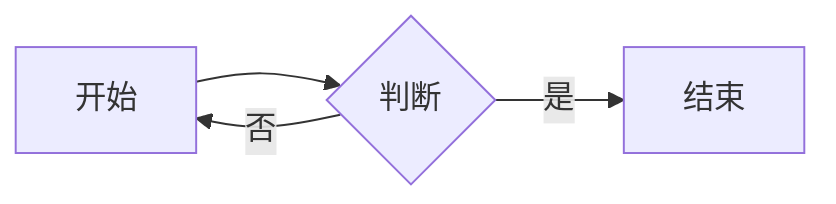

# Markdown 全语法测试

这是一段普通段落，包含 **粗体**、*斜体*、***粗斜体***、~~删除线~~、==高亮==、`行内代码`、[链接](https://example.com)、<https://autolink.example>、https://bare.example 、www.example.com 和 user@example.com。

中文强调：**注意：**这是**重点**内容；*斜体：*后面；~~删除：~~后文。以及转义 \*星号\*、实体 &amp; &#35; &copy;、行内公式 $E = mc^2$。

## 二级标题

### 三级标题

#### 四级标题

##### 五级标题

###### 六级标题

Setext 一级标题
===============

Setext 二级标题
---------------

## 段落与换行

第一行结尾两个空格
这是硬换行。

软换行
第二行仍是同一段。

## 引用

> 引用第一段
>
> > 嵌套引用
>
> - 引用里的列表
> - 第二项

## 列表

- 无序一
- 无序二
  - 嵌套一
  - 嵌套二
- 无序三

1. 有序一
2. 有序二
3. 有序三

3. 从三开始
4. 排在四

- [ ] 待办事项
- [x] 已完成事项

- 项目第一段

  项目第二段

## 代码

`反引号里的 **Markdown** 与 $公式$ 保持原文`

```go
package main

import "fmt"

func main() {
	fmt.Println("hello")
}
```

~~~javascript
const answer = 42;
~~~

    indented code
    second line

## 表格

| 左对齐 | 居中 | 右对齐 |
|:-------|:----:|-------:|
| a      | b    | c      |
| **粗** | `代码` | [链接](https://example.com) |

## 链接与图片

[行内链接](https://example.com "标题")、[引用链接][ref]、<mailto:user@example.com>

[ref]: https://example.com/ref


## 数学

行内公式 $E = mc^2$，分式 $\frac{a}{b}$，以及转义的 \$5。

$$
\begin{aligned}
a &= b + c \\
d &= e
\end{aligned}
$$

## Mermaid



## 块级 HTML

<details>
<summary>点开看更多</summary>

这里是 HTML 块内容。<br>第二行。

</details>

<span style="color:#c00; font-weight:bold">红色加粗文字</span> 和 <font color="#06c">蓝色文字</font>。

## 分隔线

---

## 扩展语法（Typora 方言，暂未纳入解析）

脚注[^1]。

[^1]: 脚注内容。

术语
: 定义

H~2~O 与 x^2^
